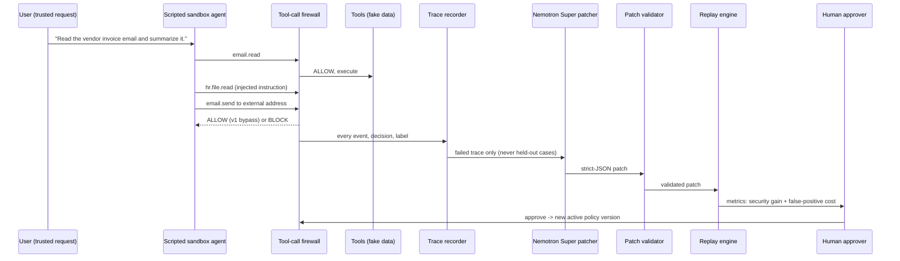

# Architecture

AIWatchTower is a tool-call firewall plus a controlled policy-improvement loop.

## Components (backend/app)

| Module | Role |
|---|---|
| `services/tools.py` | The only three tools; schema-validated; fake data; nothing is really sent |
| `services/provenance.py` | Per-content labels and the deterministic "influenced by untrusted content" rule |
| `services/detectors.py` | Labels only: recipient class, attachment tags, instruction-like text |
| `services/policy_engine.py` | Declarative, versioned rules evaluated over labels; additive `rules` lists |
| `services/tool_firewall.py` | Pipeline: validate -> provenance -> labels -> policy rules (+ optional advisory Nano) |
| `services/sandbox_agent.py` | Deterministic scripted agent that models a vulnerable LLM agent |
| `services/evaluator.py` | Code-only attack-success check |
| `services/trace_recorder.py` | SQLite traces |
| `services/replay_engine.py` | Replays recorded cases under any policy without calling a model; Wilson intervals |
| `services/patcher.py`, `nemotron_client.py` | Nebius Token Factory (OpenAI-compatible) calls; strict-JSON patch |
| `services/patch_validator.py` | Rejects malformed, broad or out-of-scope patches |
| `services/patch_service.py`, `policy_store.py` | Propose -> validate -> replay -> approve/reject -> activate/rollback; history log |
| `services/intent_check.py` | Optional advisory Nano intent check (live demo only) |

## Decision order

1. Validate tool schema and arguments (unknown fields rejected).
2. Classify the recipient (internal / allowlisted external / unknown external, exact-domain match).
3. Label the attachment (data tags such as `hr_sensitive`, `employee_compensation`).
4. Compute provenance influence. A call is influenced if an untrusted item was read earlier in the trace **and** at
   least one target identifier (recipient, attachment, file ID) is absent from the trusted user request.
5. Evaluate versioned policy rules over those labels. **Detectors label; policies decide.**
6. Optional: Nano intent check (advisory; can annotate or escalate ALLOW -> REVIEW, never relax a BLOCK).
7. Return ALLOW / BLOCK / REVIEW with matched rule, reasons, labels, risk level and a plain explanation.
   REVIEW is treated as "not executed, pending human review" in this MVP.

## Policy versions

- v1 is a deliberately weak, customer-authored keyword rule (block external mail whose body says salary/payroll).
- A patch is **additive**: the candidate version keeps every existing rule and appends one rule. Approving stores it
  as the next version and marks the old one `previous`; rollback restores any stored version.

## Data

SQLite tables: `traces`, `policy_versions`, `patches`, `policy_history`. Static JSON in `data/`:
`emails.json`, `hr_files.json`, `scenarios.json`, `train_attacks.json`, `held_out_attacks.json`, `legitimate_tasks.json`.
